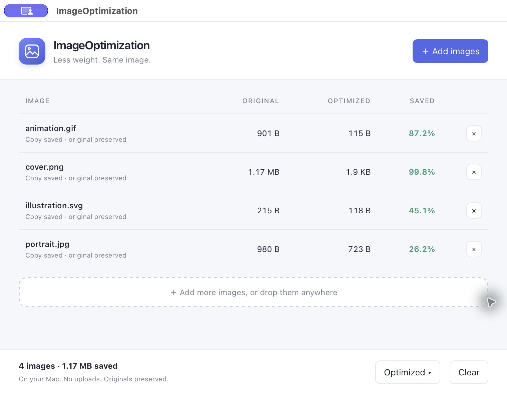

# ImageOptimization

A small, private macOS app for making images lighter. Built with **Stacks, STX and Craft**, using our TypeScript image codecs. Everything runs locally; originals stay untouched.



The screenshot shows synthetic test images processed in the real native app. Savings depend on the source image.

To update the store artwork, capture the actual native app and run `bun run screenshot /absolute/path/to/native-capture`. The exporter detects the capture's encoded format and uses our JPEG codec to produce the baseline JFIF uploaded by the release pipeline.

## Use it

Download the notarized DMG from [Releases](https://github.com/stacksjs/image-optimization/releases/latest), then drag **ImageOptimization** into Applications. Requires macOS 15 or newer on Apple Silicon. Intel and other platforms have not been verified.

Choose **Add images**, or drop files onto the window. The App Store version asks for an output folder through the native picker. The DMG version saves beside originals by default; **Output folder…** selects another destination. Smaller results are named `photo.optimized.png`. Existing files are never replaced; subsequent copies get a numbered suffix. Already optimized files are left alone. Batch processing is queued, and failures appear beside the affected image.

## Develop

```sh
pantry install
eval "$(pantry env)"        # activate the declared Bun and Craft runtimes
bun install --frozen-lockfile
./buddy dev                 # compile and launch the native app
./buddy build               # dist/ImageOptimization.app
./buddy upgrade             # update the declared dependencies
bun test tests
bun run lint
bun run test:e2e            # exercise the compiled application
bun run build:dmg           # create a local DMG
```

`buddy new . --native --adopt` integrates this repository with Stacks. The app configuration is in `craft.config.ts`; no database, web server deployment or framework vendor tree is required. Craft is resolved from PATH through Pantry. Framework contributors can set `CRAFT_BIN` to a compiled Craft executable.

`bun run dev:browser` previews the interface. Image selection and saving require the native macOS app; an unavailable native capability produces a visible error.

The installed app contains one compiled Bun backend and Craft’s official webview runtime profile. That profile keeps the native window, bridge and backend host while omitting Craft’s separate headless scripting engine. It needs no installed Bun, external codecs, network service or development checkout. Most of the bundle is its single embedded processing runtime. CI enforces a 100,000 KiB bundle budget.

Application code is TypeScript and STX. Native platform implementations belong in Craft and shared STX APIs; the application contains no Swift or Kotlin.

## Image handling

| Format | Processing |
| --- | --- |
| PNG | Recompress the original IDAT stream; retain bit depth, palettes, profiles, EXIF and APNG frame chunks. |
| JPEG | Remove comments without re-encoding pixels; retain EXIF orientation, ICC profiles and progressive scans. MPF/MPO files pass through unchanged. |
| WebP | Lossless re-encoding for static images; animated images and files with color/EXIF/XMP metadata pass through unchanged. |
| GIF | Palette tightening through `ts-gif`; retain canvas, looping, timing and interlacing. Application profiles and plain-text graphic blocks pass through unchanged. |
| SVG | Parse and remove comments through `@stacksjs/ts-svg`; preserve text spacing. |
| BMP | Re-encode; omit the alpha channel only when fully opaque. |
| AVIF | Container optimization; retain alpha, EXIF, XMP, color profiles and derived images. Animated sequences pass through unchanged. |
| TIFF, ICO, HEIC and unknown | Pass through with a format note. |

Output is used only when smaller. Invalid supported images report an error. Input is capped at 32 MiB; PNG inflation is capped at 256 MiB. WebP and BMP decoding is limited to 32 megapixels. GIFs are limited to 64 megapixels across frames.

The codecs live in their own repositories: [ts-png](https://github.com/stacksjs/ts-png), [ts-jpeg](https://github.com/stacksjs/ts-jpeg), [ts-webp](https://github.com/stacksjs/ts-webp), [ts-gif](https://github.com/stacksjs/ts-gif), [ts-svg](https://github.com/stacksjs/ts-svg), [ts-bmp](https://github.com/stacksjs/ts-bmp), and [ts-avif](https://github.com/stacksjs/ts-avif). Shared fixes are made there and consumed as versioned packages.

## Native architecture

STX compiles the interface and TypeScript backend into the app. Craft is the main macOS application process and supplies WKWebView, native file and folder panels, and file drops. It starts the bundled `stx-backend` helper and holds a lifetime pipe; the helper exits when Craft closes, including AppKit termination. The backend listens on an ephemeral loopback port, with a single-use launch session, HttpOnly SameSite cookie, and Host/Origin checks. Foreign pages cannot call the filesystem API.

New copies are written completely and synced before an atomic, non-replacing link makes them visible. Symlinks and directories are rejected. The backend stops when the native window closes. The UI holds only one batch queue and releases upload buffers after processing.

## Releases

A `v*` tag or a manual **Release macOS** workflow runs tests, builds the native app, tests the compiled executable from an unrelated directory, imports the signing identity into a temporary keychain, signs with the hardened runtime, notarizes with Apple's API, staples the DMG, verifies it, and publishes the installer with SHA-256 checksums. Signing or notarization failure stops publication.

From a clean `main` checkout, `bun run release:patch` bumps the version, commits it, and pushes the release tag to start that pipeline. Minor and major releases have matching commands.

The repository uses these GitHub secrets: `APPLE_CERTIFICATE_BASE64`, `APPLE_CERTIFICATE_PASSWORD`, `APPLE_SIGNING_IDENTITY`, and `APP_STORE_CONNECT_API_KEY`. API key ID and issuer ID are repository variables. Credentials never enter the application bundle.

For a signed local release, set `APPLE_SIGNING_IDENTITY` and either `APPLE_NOTARY_PROFILE` or the three `APP_STORE_CONNECT_API_KEY_PATH`, `APP_STORE_CONNECT_API_KEY_ID`, `APP_STORE_CONNECT_API_ISSUER_ID` values, then run:

```sh
bun run build
RELEASE=1 bun run package
```

The same workflow prepares store metadata and screenshots before packaging the Mac App Store build with Craft’s matching public API only runtime, the app sandbox,
an embedded provisioning profile, a privacy manifest, and separate inherited
helper entitlements. It validates the signed PKG with Apple, uploads it, waits
for processing, reconciles `app-store.config.ts`, selects the build, and submits it
for review. Apple controls approval and the date the store listing becomes live.
The publisher uses Pantry's App Store Connect API client and asset library,
including upload integrity checks, dynamic screenshot specifications and
idempotent review retries.

Store signing uses `APPLE_STORE_APPLICATION_CERTIFICATE_BASE64`,
`APPLE_STORE_INSTALLER_CERTIFICATE_BASE64`, `APPLE_STORE_CERTIFICATE_PASSWORD`,
`APPLE_STORE_PROVISIONING_PROFILE` and `APPLE_REVIEW_CONTACT`. Review contact is
private JSON with `firstName`, `lastName`, `phone`, and `email`. Signed artifacts
land in `dist/direct/` and `dist/app-store/`. A store build requires a unique
`BUILD_NUMBER`; CI uses the workflow run and attempt numbers.

The one-time app record and privacy label are managed in App Store Connect.
No Apple credentials, private keys, or review contact details are committed.
See [Privacy policy](PRIVACY.md) for the app's local data handling.

## License

[MIT](LICENSE.md) © Chris Breuer
